<div align="center">

# 🛋️🎮 Couch Game Studio

### Imagine a game. Say it or draw it. Play it on your TV seconds later.

**If you can imagine it, you can play it.** Kids, parents, grandparents: anyone on the couch can invent a video game out loud and play the game *they* made on Fire TV, with the remote in their hand.

**Try it live:** open [https://16-171-214-22.sslip.io/tv](https://16-171-214-22.sslip.io/tv/) on a laptop or TV browser (arrow keys and Enter act as the remote), then scan the QR code with your phone and say a game.


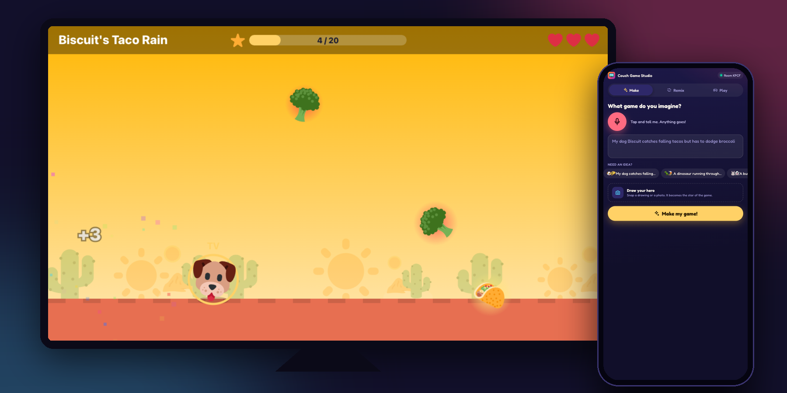

</div>

Maya picks up a phone and says *"my dog Biscuit catches falling tacos but has to dodge broccoli"*. Or she snaps a photo of her crayon drawing. The TV reads her words back one at a time while the game is imagined, little robots play it to make sure she can win, and a few seconds later Biscuit is on the big screen, catching tacos. Her brother joins from his phone as player 2. Grandpa says *"make it night and give me a boss"*, and the remix is ready before the snacks are.

Built for the **Build, Ship, Shape: Amazon Developer Hackathon**: Fire TV track, plus the AWS Builder and Open Source mini challenges.

<table>
<tr>
<td width="50%">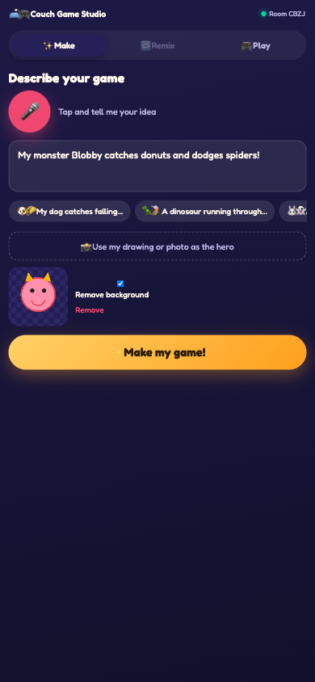<br><sub><b>Imagine it</b>: say it, type it, or snap a drawing. No app to install.</sub></td>
<td width="50%">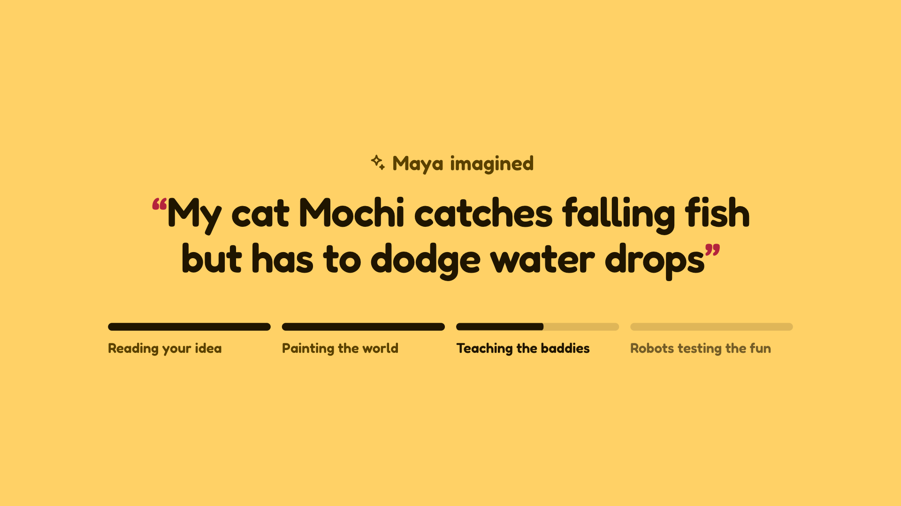<br><sub><b>Imagining…</b>: your own words appear on the TV, one at a time</sub></td>
</tr>
<tr>
<td>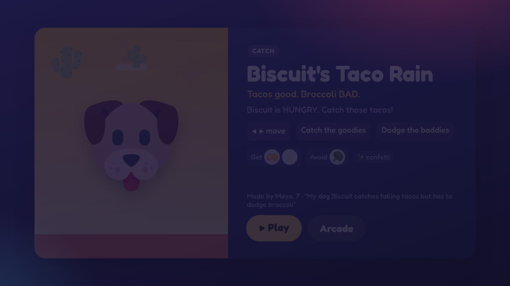<br><sub><b>Intro card</b>: who imagined it, how to play, what to grab and dodge, and how the robots did</sub></td>
<td>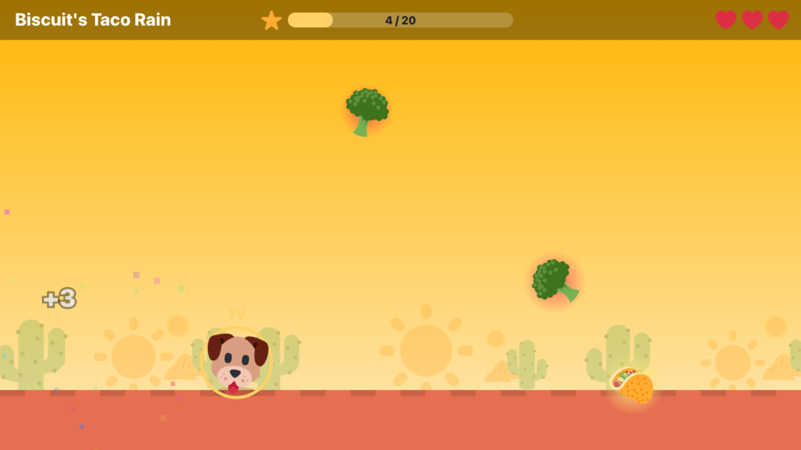<br><sub><b>Catch</b>: "my dog Biscuit catches falling tacos…"</sub></td>
</tr>
<tr>
<td>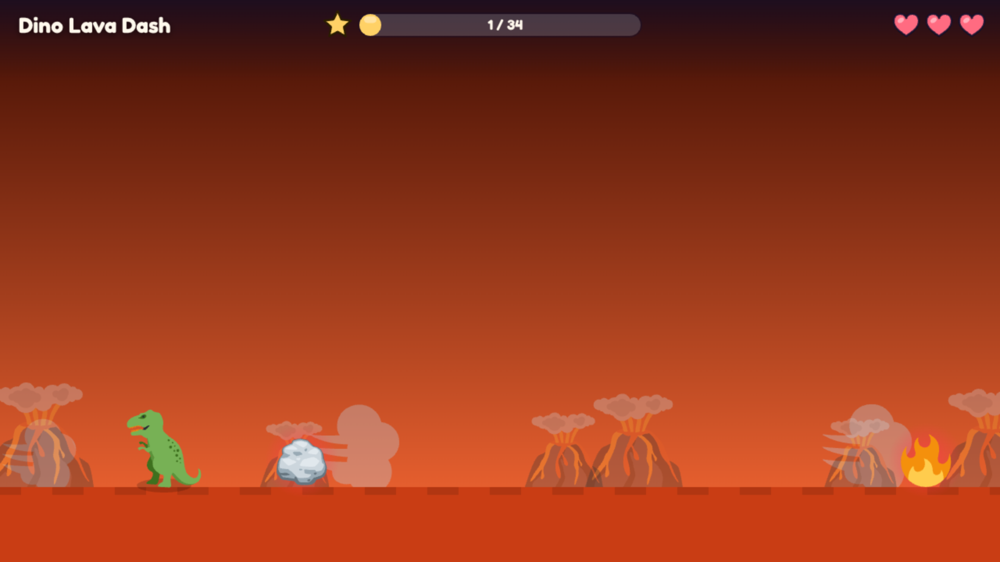<br><sub><b>Run &amp; Jump</b>: "a dinosaur running through a volcano…"</sub></td>
<td>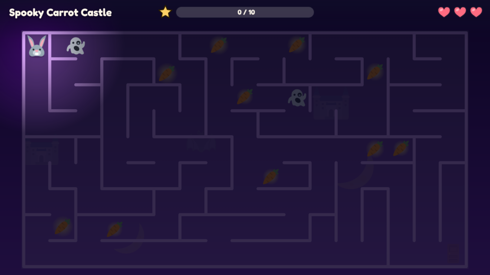<br><sub><b>Maze + night mode</b>: "a bunny in a spooky castle…"</sub></td>
</tr>
<tr>
<td>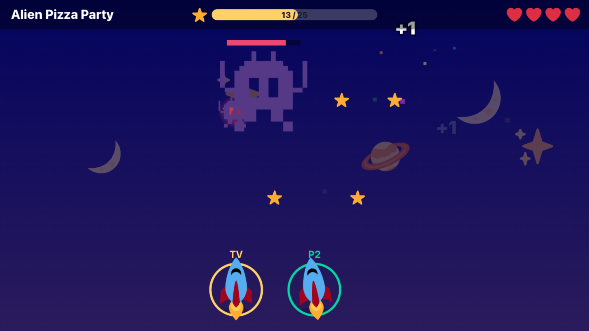<br><sub><b>Zap + boss + co-op</b>: "a rocket zapping aliens…"</sub></td>
<td>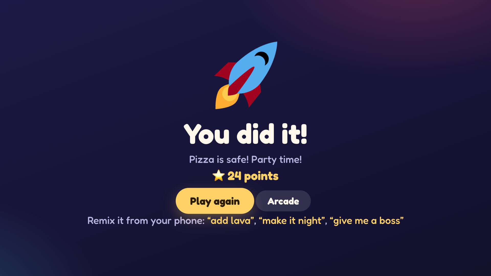<br><sub><b>You did it!</b>: family podium, new records, confetti</sub></td>
</tr>
<tr>
<td>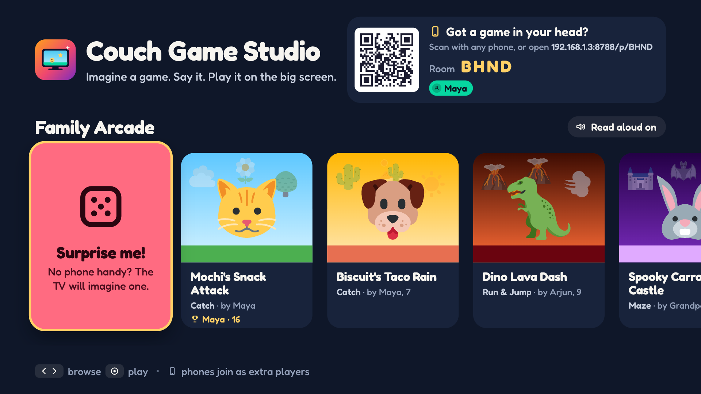<br><sub><b>Family Arcade</b>: every game the family has imagined, D-pad first</sub></td>
<td>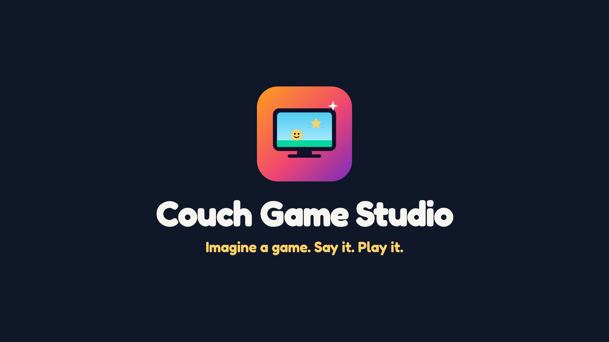<br><sub><b>On Fire TV</b>: a native Vega app with a branded splash screen</sub></td>
</tr>
</table>

---

## Why

People of every age imagine games. Very few get to *make* one.

- **"How do I help my kid make a game?"** A 6-year-old asks his uncle to make a game together, and the top reply in r/learnprogramming has 361 upvotes. The same question keeps returning in r/gamedev and r/learnprogramming through 2024 and 2025. Every answer points to tools that need reading, typing and a laptop.
- **"How do I make screen time creative instead of passive?"** Parents ask this constantly in r/Parenting, r/daddit, r/Mommit and r/ParentingADHD (2025–2026).
- **Families want to play together.** Most game makers are single-player and desk-bound. The living room is where everyone already is.

The TV is the biggest screen in the house, and it's the one we only ever *watch*. Couch Game Studio turns it into something the whole family *makes* with, and nobody has to type a word or read a manual.

## What it does

| | |
|---|---|
| **Imagine** | Say or type your game on any phone. Scan the QR code on the TV; there's nothing to install. |
| **Draw** | Snap a crayon drawing or a photo of the family dog. The background is removed on the phone and it becomes the hero. |
| **Design** | A **Game Director agent** on Amazon Bedrock turns the idea into a validated *GameSpec*: genre, hero, goodies, hazards, world colors, rules and modifiers. It keeps every detail you imagined. |
| **Robot-test** | Before anyone plays, kid-skill and grown-up-skill robots play the game and the balancer tunes it so a kid can win. *"Make it super hard"* stays hard, and still winnable. |
| **Play** | Four game types (**Catch**, **Run & Jump**, **Maze**, **Zap**) and twelve modifiers: night mode, lava floor, giant hero, boss fights, wind, rainbow trail, reverse controls and more. Fully playable with the Fire TV remote. |
| **Play together** | Up to 4 players. The remote is player 1; phones become controllers whose layout changes with each genre. Everyone can send emoji cheers that float up on the TV. |
| **Remix** | *"Make it faster and put it at night."* Every remix is a new version in the **Family Arcade**, and the original stays. |
| **Celebrate** | Family high scores on a podium, a *New record!* moment, and confetti on wins. |

### Made for the couch, the 10-foot screen and small hands

- **Read-aloud narration.** The TV can speak titles, intros and results, for players who can't read yet. One toggle turns it off.
- **D-pad first.** Spatial focus, one clear focus style, big type, and Back / Play-Pause handled the Vega way.
- **No dead ends.** A 3-2-1-GO countdown, double-jump, maze loops instead of traps, and gold glow for *grab it*, red glow for *dodge it*, readable from across the room.
- **Waiting is part of the fun.** The imagining screen reveals your own words one at a time while the game is made. The intro card shows how to play, what to grab and dodge, and the robots' verdict (*"Robots played it 12×: kids won 75%"*).
- **A real design system.** Self-hosted Fredoka type, an authored SVG icon family, token-based styles, procedural chiptune music and sound effects. The phone companion matches the TV.
- **Grown-ups stay in charge.** Remove a game from the arcade with a confirm step (it's hidden, not destroyed).

## How it works

```
 Phone (any browser)        Studio server (Node 22, Express 5)                 Fire TV (Vega OS)
 ───────────────────        ──────────────────────────────────                 ─────────────────
 say / type / draw ─HTTPS─► safety layer (personal details out, kind words in)
                              │
                              ▼
                            Game Director agent  ⇄  playtest_game tool
                            (Strands on Bedrock)     robot playtester + auto-balancer
                              │                      (couch-engine/playtest)
                              │ fallback: 2nd model → Converse → offline designer
                              ▼
                            GameSpec  (Zod + normalizeSpec, balanced again)
                              │
                              ├──► Family Arcade (JSON files, atomic writes)
                              │
 controller / cheers ─ws──► room relay ───────────── ws ───────────────►  React Native for Vega app
                                                                           └─ WebView: TV app
                                                                              └─ couch-engine canvas, 60 fps
```

**The model never writes code.** It fills in a small, strict *GameSpec* that the engine already knows how to run. That's why every game is fast to make, safe for kids, and can't crash.

1. **Safety first.** `server/safety.js` cleans the words before anything else sees them.
2. **The Game Director agent** (`server/agent.js`) is a [Strands Agents](https://strandsagents.com) TypeScript agent on Amazon Bedrock. By default it runs Qwen3 235B through **Bedrock Mantle**, Bedrock's OpenAI-compatible endpoint (Strands `OpenAIModel` with `bedrockMantleConfig`, authenticated with short-lived tokens minted from your AWS credentials); it can also run on the Converse API (`BedrockModel`). It drafts a GameSpec, calls its `playtest_game` tool (robot players from `couch-engine`), reads the win rates, revises with *creative* fixes if kids rarely win, and returns its answer as **Zod-validated structured output**. Up to three playtests per game.
3. **Designer chain** (`server/llm.js`): Game Director on Mantle (Qwen3 235B, then Kimi K2.5) → Game Director on the Converse API → a single Bedrock **Converse** call with a `make_game` tool → the **offline designer** (keywords plus the open emojilib dictionary, so "flies", "logs" and "gears" become sprites). A provider that fails is skipped for a minute, so the TV never hangs and the demo works with no network at all.
4. **Every path is balanced again** (`server/designer.js`). Difficulty comes from the player's own words: *"for my little brother"* means easy, *"super hard"* means hard.
5. **The TV** (`public/tv/`) runs the spec with [`couch-engine`](https://github.com/priteshvirat24/couch-engine), served from the package at `/engine/`. Phones (`public/phone/`) talk to it through a small WebSocket room relay (`server/rooms.js`).
6. **Fire TV** (`vega/`) is a React Native for Vega app that hosts the TV experience in `@amazon-devices/webview`.

> **Typical numbers:** the Game Director designs and playtests a game in about 7–15 seconds on Bedrock Mantle. A daily cap (`BEDROCK_DAILY_LIMIT`, default 150 designs) keeps a busy demo from running up the bill; past it, the offline designer takes over.

### The Fire TV app

Built with guidance from the **Amazon Devices Builder Tools** MCP server (we used its docs search and read tools for splash, icon and performance guidance):

- Branded native splash screen (`vega/assets/raw/SplashScreenImages.zip`, 1920×1080), held until the studio is on screen.
- 512 px app icon declared in `manifest.toml`.
- Time-to-fully-drawn reported with `@amazon-devices/kepler-performance-api` for **cold and warm starts**.
- A friendly "Can't reach the game studio" screen with a focused **Try again** button.
- Back on the TV home screen exits the app through a WebView message bridge.
- 4 Jest tests, lint clean, manifest validation with 0 errors.

## Kid safety

Safety is layered, so no single step has to be perfect.

- **Personal details are removed** before anything is stored, shown on the TV or sent to a model: emails, phone numbers, street addresses and links.
- **Cartoon violence is softened, not refused.** "kill" becomes "bonk", "gun" becomes "water blaster", "blood" becomes "ketchup". Games are allowed cartoon baddies.
- **Unsuitable topics get a friendly nudge** (*"How about animals, space, snacks or monsters?"*) instead of a game or an error.
- **Names are sanitized** before they appear on the TV.
- **The model fills in data, never code.** Its output is schema-validated and clamped, and the agent is told to keep everything kind and age-appropriate.
- **Drawings stay home.** Photos are checked to be real images and saved on your studio server; they are never sent to the model.
- **No accounts, no ads, no chat.** Phones join a room by QR code, and cheers are a single emoji, never free text.

## Run it

**Requirements:** Node 22+. Docker and the Vega SDK are optional.

```bash
npm install
npm start                       # http://localhost:8787/tv/
```

Open `http://localhost:8787/tv/` in a browser (arrow keys and Enter act as the remote) and scan the QR code with a phone on the same Wi-Fi. `npm run dev` restarts on file changes.

**Generative AI on Amazon Bedrock** (optional; without it the offline designer is used):

```bash
cp .env.example .env            # then edit, or export the variables directly
export AWS_REGION=eu-north-1    # plus your usual AWS credentials (env, profile or role)
# Defaults: Qwen3 235B, then Kimi K2.5, on Bedrock Mantle. Override with BEDROCK_MANTLE_MODELS.
```

**Docker** (non-root image, health check, games kept in a `/data` volume):

```bash
npm run docker:build
npm run docker:run              # docker run -p 8787:8787 -v couch-data:/data couch-game-studio
```

**A public HTTPS link** lets phones on any network join, enables voice input on phones, and is what the Fire TV app loads:

```bash
cloudflared tunnel --url http://localhost:8787
```

Phone links follow whatever address the TV used. Set `PUBLIC_URL` to pin one.

### On AWS (permanent HTTPS address)

[`infra/aws/studio.yaml`](infra/aws/studio.yaml) is a CloudFormation stack: one Graviton EC2 instance with a fixed Elastic IP, running the studio as a hardened systemd service (Amazon Linux 2023, Node 22) behind **Caddy**, which gets a trusted Let's Encrypt certificate for `<elastic-ip>.sslip.io` on its own. The result is a permanent `https://` address with WebSockets, no domain needed.

- Only ports 80 and 443 are open. The Node server listens on `127.0.0.1`; there is no SSH (admin and updates go through Systems Manager).
- No AWS keys on the server: an IAM role grants Bedrock Mantle. IMDSv2 only, encrypted disk, checksum-verified Node and Caddy downloads.
- The stack only reports success once `https://<host>/healthz` answers with a valid certificate.

```bash
infra/aws/deploy.sh             # create or update the stack, prints the StudioUrl (first run ~10 min)
infra/aws/update.sh             # ship the latest main to the running server, keeping every game
```

Use `update.sh` for code changes. Re-running `deploy.sh` after editing the instance's boot script replaces the server, which starts with an empty arcade.

Put the `StudioUrl` in `vega/src/config.ts` and rebuild the Fire TV app once; the address never changes while the stack exists. Running cost is roughly $10 a month (t4g.micro, public IPv4, 16 GB disk). `aws cloudformation delete-stack --stack-name couch-game-studio` removes everything, including the games stored on the server.

### On Fire TV (Vega OS)

Step-by-step guide with a test checklist: [docs/FIRE_TV_HANDOFF.md](docs/FIRE_TV_HANDOFF.md).

The Vega WebView runs on the Vega Virtual Device only on Apple-silicon Macs (per Amazon's docs).

```bash
# 1. Install the Vega SDK: https://developer.amazon.com/docs/vega/latest/install-vega-sdk.html
# 2. Point the app at your studio over HTTPS (WebView blocks plain HTTP by default):
#    vega/src/config.ts  ->  STUDIO_URL (set to the AWS studio; use your own host or tunnel to change it)
cd vega
npm install
npm run build                   # armv7, aarch64 and x86_64 .vpkg files in build/
vega virtual-device start
vega run-app build/aarch64-release/couchgamestudio_aarch64.vpkg com.couchgamestudio.tv.main
# A Fire TV Stick in developer mode uses build/armv7-release/couchgamestudio_armv7.vpkg
```

## Configuration

Everything is optional and set through environment variables (see [`.env.example`](.env.example)).

| Variable | Default | What it does |
|---|---|---|
| `PORT` | `8787` | HTTP and WebSocket port |
| `HOST` | `0.0.0.0` | Interface to listen on |
| `PUBLIC_URL` | auto | Public HTTPS address phones should use (a tunnel or your domain) |
| `DATA_DIR` | `./data` | Where games, drawings and the emoji cache are stored |
| `AWS_REGION` | your AWS profile's Region | Region for Amazon Bedrock (`BEDROCK_REGION` overrides it) |
| `BEDROCK_MANTLE_MODELS` | `qwen.qwen3-235b-a22b-2507,moonshotai.kimi-k2.5` | Models the Game Director tries, in order, on Bedrock Mantle |
| `BEDROCK_MODEL_ID` | see `.env.example` | Model or cross-region inference profile for the Converse API path |
| `BEDROCK_DAILY_LIMIT` | `150` | Bedrock designs per day before the offline designer takes over |
| `LLM_PROVIDER` | `auto` | `auto` = Mantle → Converse agent → Converse → offline. `mantle`, `agent`, `converse` or `offline` force one designer (offline is always the last resort) |
| `LLM_TIMEOUT_MS` | `60000` | Time limit for one design request |
| `PLAYTEST` | `on` | Robot playtesting of every new game (`off` to skip) |
| `CREATE_PER_MINUTE` | `8` | Make and remix requests allowed per minute, per device |
| `ORIGIN_SECRET` | none | Behind a CDN such as CloudFront: reject any request without this value in `X-Origin-Verify` (`/healthz` stays open) |
| `TRUST_PROXY` | `true` | Proxy hops in front of the server, used to find each device's IP for rate limiting (`1` behind a single proxy such as Caddy) |

## Production-ready server

- Modular: `config` → `store` → `rooms` → `designer` → `app`, on **Express 5**.
- Content Security Policy and security headers, gzip compression, per-device rate limiting with friendly messages.
- One JSON file per game, written atomically (a crash never leaves half a game). Back up by copying `data/`.
- `/healthz` health check and `/api/status` (version, games, rooms, designer chain).
- Graceful shutdown on SIGINT / SIGTERM.
- Errors reach players as kind sentences, never stack traces.

## Tests

```bash
npm test                        # 24 server tests
cd vega && npm run lint && npm test    # Vega app: lint + 4 Jest tests
```

The server suite covers the GameSpec contract, the offline designer and remixes, the agent's structured-output schema and `playtest_game` tool, and **end-to-end API and WebSocket tests**: making and remixing games, unsafe ideas, *"super hard"* staying hard, family scores, hiding games, rooms and QR codes, the phone-to-TV relay, rate limiting, and the CDN origin guard. `couch-engine` has its own 10 tests.

[GitHub Actions](.github/workflows/ci.yml) runs the server tests on Node 22 and 24, builds the Docker image and smoke-tests it, then lints and tests the Vega app.

## Project structure

```
couch-game-studio/
├── server/
│   ├── index.js        entry point, graceful shutdown
│   ├── app.js          HTTP routes, security headers, static files
│   ├── config.js       environment configuration
│   ├── safety.js       kid-safety layer
│   ├── designer.js     safety → designer → robot playtest pipeline
│   ├── agent.js        Game Director agent (Strands on Amazon Bedrock)
│   ├── llm.js          designer chain: Mantle → Converse → offline, daily cap
│   ├── spec.js         GameSpec contract (from couch-engine) + offline designer
│   ├── store.js        Family Arcade storage, scores, hide/restore
│   ├── rooms.js        TV ⇄ phone WebSocket rooms
│   ├── ratelimit.js    per-device token bucket
│   ├── seeds.js        starter games
│   └── *.test.js       24 tests
├── public/
│   ├── tv/             10-foot TV app
│   ├── phone/          phone companion
│   └── assets/         Fredoka font, SVG icon family, app icons
├── vega/               React Native for Vega app (Fire TV)
├── docs/               submission pack, demo script, screenshots
├── infra/aws/          CloudFormation stack, deploy and update scripts
├── Dockerfile
└── .github/workflows/ci.yml
```

## Open source

The engine is its own project: **[couch-engine](https://github.com/priteshvirat24/couch-engine)** (Apache-2.0, zero dependencies, v1.1.1).

- A canvas game engine for TVs: 4 genres, 12 stackable modifiers, 4-player co-op, D-pad controls, chiptune audio.
- The GameSpec contract: `normalizeSpec()` turns anything into a valid game, and `SPEC_JSON_SCHEMA` is ready to use as a model tool or structured-output schema.
- A **robot playtester and auto-balancer**. Seeded, deterministic bots play every game in about 20–300 ms. `balance()` tunes speed, spawn rate, lives and goal toward a 60–95% kid win rate with wins in 25–110 seconds, honors `easy | normal | hard`, removes the hardest modifier only as a last resort, and never touches creative choices.

Couch Game Studio installs it from GitHub (`github:priteshvirat24/couch-engine#v1.1.1`) and uses it on both sides: the server playtests with it, and the TV plays with it.

## Built with

- **Fire TV / Vega OS:** React Native for Vega, `@amazon-devices/webview`, `@amazon-devices/kepler-performance-api`, the Vega CLI and Vega Virtual Device, Amazon Devices Builder Tools (MCP).
- **AWS:** Amazon Bedrock (Mantle OpenAI-compatible endpoint with Qwen3 and Kimi K2.5, Converse API, tool use, cross-region inference profiles), Strands Agents SDK for TypeScript (`@strands-agents/sdk`), AWS SDK for JavaScript v3.
- **Server:** Node.js 22, Express 5, `ws`, `zod`, `compression`, `qrcode`, Docker, GitHub Actions.
- **Engine:** [couch-engine](https://github.com/priteshvirat24/couch-engine) (canvas, WebAudio).
- **Hosting:** AWS CloudFormation, Amazon EC2 (Graviton) with an Elastic IP, AWS Systems Manager, Caddy with Let's Encrypt. Cloudflare quick tunnels for local development.

## License and credits

Apache-2.0. See [LICENSE](LICENSE).

- Emoji graphics: [Twemoji](https://github.com/jdecked/twemoji), CC-BY 4.0.
- Emoji keywords: [emojilib](https://github.com/muan/emojilib), MIT.
- Typeface: [Fredoka](https://fonts.google.com/specimen/Fredoka), SIL Open Font License (`public/assets/fonts/OFL.txt`).
